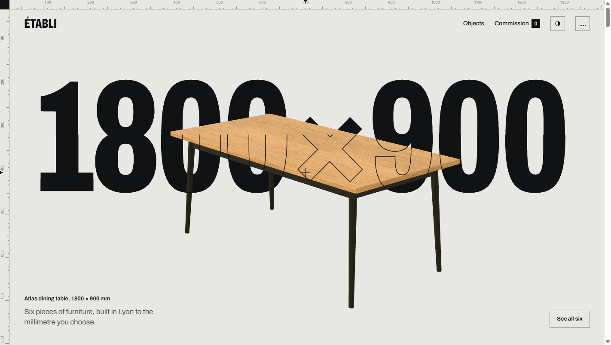
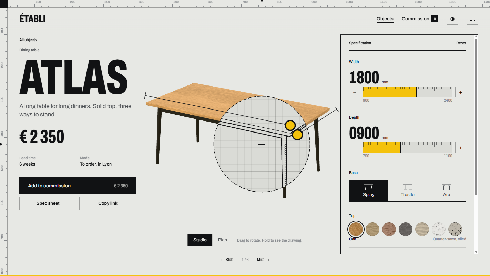

# ÉTABLI

A made-to-measure furniture configurator for a fictional workshop. Six objects, each built as live parametric geometry, so a table really gets longer when you drag its edge instead of being scaled.



## What's in it

- **Home**: one reversible scroll story. The table explodes into parts with drawing callouts, the collection slides past on a rail, a plan view stretches the table from 900 to 2400 mm while seats are counted, materials can be dragged onto a stool, and the desk lamp switches the site to night.
- **Objects**: live 3D objects sitting in their cards, with a Studio grid and a Plan archive (front elevations) switched with GSAP Flip. Clicking a card flies the object into the configurator.
- **Configurator**: drag the dimension handles or use the tape-measure sliders. Materials bleed in from wherever a swatch is dropped. Studio and Plan (front, side, top) views, a hold-to-see-the-drawing lens, an A4 spec sheet download, and shareable URLs that encode the configuration.
- **Commission**: an order sheet with snapshot thumbnails of each configuration and a request form. No payment is taken.



## Objects

| Object | Type | What you can change |
|---|---|---|
| Atlas | Dining table | Width 900–2400 mm, depth, three bases, top and base materials, finish |
| Mira | Lounge chair | Frame style, upholstery, frame material, finish |
| Orbit | Desk lamp | Reach, height, colour temperature 2700–4000 K, shade, body |
| Tripod | Stool | Height 450–800 mm, seat shape, seat and leg materials |
| Grid | Modular shelving | 1–6 columns, 1–5 rows, open or backed, body |
| Slab | Side table | Diameter, height, three bases, stone top, finish |

## Stack

React 19, React Three Fiber 9, three.js r186, drei, three-custom-shader-material, GSAP (ScrollTrigger, Flip, SplitText, DrawSVG, ScrambleText), Lenis, Zustand, React Router 7, Vite 8, Tailwind 4 (reset only), Archivo (Fontsource).

Notable choices:

- **One clock.** GSAP's ticker steps Lenis, runs DOM frame hooks, then renders the canvas (`frameloop="never"`), so DOM and WebGL never drift apart.
- **One persistent canvas** behind every route; pages drive it through plain mutable rigs (`src/webgl/rigs.js`), so objects can move between pages.
- **Procedural geometry** for every object (`src/webgl/objects/builders.js`), with a drawing-to-matter sweep shader and an ink-bleed material blend (`src/webgl/draft/`).
- **Sound** is synthesised with Web Audio (off by default); nothing is downloaded.

## Getting started

```bash
git clone https://github.com/Diallo222/Table-Configurator.git
cd Table-Configurator
yarn install
yarn dev
```

| Script | What it does |
|---|---|
| `yarn dev` | Start the dev server |
| `yarn build` | Production build to `dist/` |
| `yarn preview` | Serve the production build |
| `yarn lint` | ESLint |
| `yarn textures` | Re-download the Poly Haven textures and convert them to WebP (already committed in `public/textures`) |

## Project layout

```
src/
  app/        App shell and routes
  core/       clock, scroll, pointer, route transitions, sound
  data/       catalog, materials, pricing
  store/      Zustand stores (config, cart, UI)
  dom/        chrome, loader, UI kit, pages
  webgl/      canvas, stage, objects, draft shaders
  styles/     tokens and CSS
docs/
  CONCEPT.md  art direction and experience design
  PLAN.md     implementation plan and decision log
```

## Credits

Wood and fabric textures from [Poly Haven](https://polyhaven.com) (CC0). ÉTABLI is a fictional brand; nothing here can be bought.

## License

[MIT](LICENSE) © Almahady Diallo
